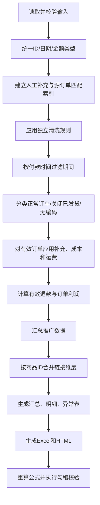

# 订单利润核算标准化程序开发文档

## 1. 文档信息

| 项目 | 内容 |
|---|---|
| 文档类型 | 技术设计与开发规范 |
| 目标系统 | 订单、货品成本、售后退款、运费与推广费用一体化利润核算程序 |
| 主要读者 | Python 开发人员、数据运营人员、验收人员 |
| 当前业务口径 | 以配置的开始日期和结束日期为准；示例期间为 2026-08-01 至 2026-08-07；平台由运行参数明确指定 |
| 规范版本 | 1.2（2026-10-12，实际运费改为按订单号汇总匹配） |
| 交付物 | Excel 成本利润分析表、链接维度 HTML 分析页、运行日志和异常清单 |

## 2. 建设目标

将目前依赖人工整理的订单利润分析流程固化为可重复执行的标准程序。程序必须做到：

1. 同一批输入得到同一批输出，重复运行不产生重复数据。
2. 所有删除、排除、补充和计算均可追溯到原始行及处理原因。
3. 不用零值代替未知成本，不以推广归因成交金额重复增加订单销售额。
4. 汇总、订单明细、商品链接分析三种粒度的金额能够相互勾稽。
5. 日期、文件路径和输出目录通过参数传入，禁止硬编码具体月份、行号或 Excel 范围。
6. 对新增行、不同文件行数、CSV 编码和 Excel 公式重算具备稳定处理能力。
7. 提供中文命令行界面，包含可定位错误、运行进度和摘要；首版完成核算内核后增加基于 Tkinter 的本地桌面启动器，用于选择文件、日期、平台和输出目录。桌面界面只调用同一流水线，不复制业务规则。

## 3. 非目标

首版不建设数据库、后台管理系统、在线多人协作或定时调度平台。后续只有在数据量、多人使用或自动调度成为真实需求时再引入数据库和 Web 服务。

## 4. 核算粒度与核心术语

### 4.1 核算粒度

- **订单明细行**：清洗、退款、成本和运费的最小计算单位。
- **主订单**：通过 `主订单编号` 去重统计订单数。
- **商品链接**：订单表 `商品ID` 与推广表 `主体ID` 归一化后形成的同一维度。
- **期间汇总**：指定日期区间内所有有效订单和推广数据的合计。

当前逻辑按订单明细行判断删除条件，不自动向同一主订单的其他明细行级联。若未来需要“任一明细命中则删除整个主订单”，必须作为独立业务变更实现并重新验收。

### 4.2 关键金额

- **实收金额**：订单明细中的 `买家应付货款`。
- **有效退款**：仅当 `退款状态 = 退款成功` 时取 `退款金额`，否则为 0。
- **货品成本**：该订单明细对应的全部货品成本。
- **运费**：该订单明细对应的运费，可能存在一个订单多包裹发货。
- **订单利润**：实收金额 − 有效退款 − 货品成本 − 运费 − 平台扣点 − 综合税赋。平台由运行参数指定：`tmall` 的扣点率为 6%，`taobao` 的扣点率为 0.6%；程序不得从商品标题、备注或文件名猜测平台。平台扣点与综合税赋的共同计费基数为 `MAX(实收金额 − 有效退款, 0)`，综合税赋率为 2.3%。两项费用均在每条订单明细上使用 `ROUND_HALF_UP` 量化到分后再汇总。
- **关闭已发货损失**：交易关闭且存在物流单号时的货品成本 + 运费，以正数展示并从利润中扣除。
- **推广花费**：推广报表指定期间内 `花费` 的合计。
- **含推广净利润**：正常订单利润 − 关闭已发货损失 − 推广花费。
- **推广归因成交金额**：仅用于投产分析，不计入订单销售额。
- **补差价专用**：订单明细 `商品标题` 去除首尾空格后精确等于 `补差价专用` 的虚拟收款商品。该明细实收正常计入销售额，不受商家编码为空排除规则影响；货品成本是业务明确的 0 元，不属于未知成本。若主订单编号匹配到实际运费，仍优先计入分配后的实际运费；未匹配时，虚拟商品运费最终回退为业务明确的 0 元。退款、平台扣点和综合税赋仍按正常订单规则计算。所有订单均已取消低于 20 元清洗规则。

## 5. 输入文件契约

### 5.1 订单表

支持 `.xlsx`，工作表名称可配置，默认 `export`。必需字段：

| 字段 | 类型 | 用途 |
|---|---|---|
| 主订单编号 | 字符串 | 主订单去重、补充数据匹配 |
| 商品ID | 字符串 | 商品链接维度 |
| 商品标题 | 字符串 | 展示 |
| 购买数量 | 数值 | 成本计算与数量汇总 |
| 订单状态 | 字符串 | 正常订单、关闭订单分类 |
| 商家编码 | 字符串 | 成本匹配；为空时排除 |
| 买家应付货款 | 金额 | 实收金额 |
| 退款状态 | 字符串 | 判断有效退款 |
| 退款金额 | 金额或“无退款申请” | 退款金额 |
| 订单付款时间 | 日期时间 | 期间过滤 |
| 商家备注 | 字符串 | D/S 刷单标记识别 |
| 物流单号 | 字符串 | 判断是否已发货、保留物流审计；不用于匹配实际运费 |

原始订单表不提供、也不要求提供`货品成本`和`运费`列。程序在标准化时创建内部空值字段，再分别根据成本编码表和运费表解析；仍无法解析的金额才进入人工补充流程。成本、运费及其来源只出现在程序的中间结果和输出报告中，不回写原始订单文件。

订单编号、商品ID和物流单号必须按字符串读取：去除首尾空格；`None`、`NaN` 和空白统一为空字符串；只有读取值本身为整数型数值或形如整数的浮点数时才移除末尾 `.0`，字符串 ID `"123.0"` 不得擅自改写。若 Excel 已把带前导零的 ID 保存为数值，程序无法恢复前导零；若 ID 以数值形式保存且绝对值超过 `9,999,999,999,999,999`、使用科学计数法显示或出现疑似精度损失，本次运行失败并报告输入质量问题。

`买家应付货款` 的输入契约是“当前商品明细行金额”，不是在多条明细上重复出现的主订单总额。程序必须检测同一主订单多行金额完全相同等可疑情况并输出警告，但未经明确分摊规则不得自行重分配。

### 5.2 成本编码表

默认工作表 `Sheet1`，必需字段：

| 字段 | 类型 | 说明 |
|---|---|---|
| 编码 | 字符串 | 与订单表商家编码精确匹配；兼容表头`商家编码`，两列并存时以`编码`为准 |
| 成本 | 金额 | 单件货品成本；兼容表头`单件成本` |
| 运费 | 金额 | 无实际运费时的订单明细总运费候选值；兼容表头`单件运费`；不乘购买数量，不代表主订单或包裹总运费 |

同一编码若出现多条不同成本或不同标准运费，本次运行必须失败并返回非零退出码；成本和运费均相同的完全重复行只保留一条。程序不能静默取第一条或只跳过该编码。组合商品必须在成本表中有明确组合编码或 BOM 映射；禁止仅凭 `+`、`*` 等文本符号猜测组成。

### 5.3 运费表

支持 `.xls`/`.xlsx`，主要字段：

- `运单号`
- `订单编码`
- `总运费`

实际运费以订单号为唯一匹配口径：将 `订单编码` 按第一个下划线拆分，取前缀并去除首尾空格作为 `主订单编号`，完整保留原始订单编码和运单号用于审计。例如 `3316502714015000499_DPK301941292143` 对应订单 `3316502714015000499`；无下划线时取完整订单编码。订单号保持字符串，不转数值，保留前导零与长整数精度。

同一运单号的相同订单归属、相同总运费记录只计一次；同一运单号对应不同订单或不同总运费时运行失败。不同运单号属于同一订单时，先逐笔转换为整数分，再相加得到该订单的实际总运费；子母件的母件金额和子件 0 元自然汇总，不取第一条、不取最大值。订单编码为空或下划线前缀为空的行保留在输入审计中，不参与匹配、不猜测归属；`validate-inputs` 和 `run` 的运行清单均必须输出带源行位置的 `FREIGHT_ORDER_ID_MISSING` 警告。

只将订单实际总运费分配给本期有效正常订单和关闭已发货明细，具体分摊及回退规则以第 7.5 节为准。物流单号不同、为空或只上传子单号均不影响订单号匹配；不再跨主订单按共享运单分摊，也不保留运单号匹配的兼容路径。

### 5.4 售后表

售后表用于复核退款，不直接与订单表中的同一笔退款叠加。主要字段：

- `订单编号`
- `退款编号`
- `退款状态`
- `退款总额`
- `退款完结时间`

售后表使用 `订单编号 = 订单表.主订单编号` 做主订单级复核，去重键为 `退款编号`。所有字段完全相同的重复行保留一条；同一退款编号去重后仍存在多条且任一核算字段不同，本次运行失败。仅 `退款状态 = 退款成功` 的记录参与复核；复核期间按 `退款完结时间` 使用与第 7.3 节相同的半开区间。期间内成功退款先按主订单编号汇总，再与订单表同主订单的有效退款合计比较，差异按分输出。首版售后表只用于一致性检查，任何售后金额都不追加到利润；无法唯一归属到商品明细时只报告主订单级差异。未来若要纳入订单表遗漏的额外售后，必须先新增独立需求，明确标记字段、订单明细匹配键和多商品归属规则。

### 5.5 推广报表

CSV 默认编码为 `GB18030`，必需字段：

| 字段 | 类型 | 用途 |
|---|---|---|
| 日期 | 日期 | 期间过滤 |
| 主体ID | 字符串 | 与商品ID关联 |
| 主体名称 | 字符串 | 展示 |
| 展现量 | 数值 | 推广分析 |
| 点击量 | 数值 | 推广分析 |
| 花费 | 金额 | 从利润中扣除 |
| 总成交金额 | 金额 | 计算推广 ROI，不计入订单销售额 |
| 总成交笔数 | 数值 | 推广分析 |

程序必须根据实际数据行动态汇总，禁止使用 `G2:G739` 一类固定范围。使用 pandas 汇总时以 DataFrame 实际行数为准；写入 Excel 公式时使用表格列、整列范围或根据 `max_row` 生成范围。

### 5.6 人工补充表

人工补充成本和运费的基础匹配键：

```text
主订单编号 + 商品ID + 商家编码
```

当基础匹配键对应多条源订单明细时，使用可选字段`明细序号`（原订单 Excel 行号）唯一定位。程序在`PROVISIONAL`状态下自动生成`待补成本运费.xlsx`，其第一张`人工补充表`已预填基础匹配键和明细序号，可直接回填后作为人工补充表再次导入。为便于人工核对，列顺序以`主订单编号、商品ID、商品标题、商品属性、用户付款金额`开头；用户付款金额取订单明细的买家应付货款，仅用于展示，不参与人工补充输入。

字段包括`明细序号`（可选）、只读的原`商家编码`、`货品成本`、`运费`和`补充状态`。新生成的待补表不提供补充商家编码列。输入的成本和运费均表示“订单明细总金额”，不再乘购买数量。对于原订单商家编码为空的明细，程序自动生成带明细序号的草稿行；用户必须同时填写货品成本和运费，确认后该明细无需商家编码即可重新分类并进入核算。已有商家编码的明细按缺失项目填写成本和/或运费。处理要求：

1. 基础三字段组合在不使用明细序号时必须唯一；提供明细序号时，四字段组合必须唯一。
2. 允许生效的状态为 `已确认`、`已同步` 或空值；`草稿`、`作废` 不参与计算；出现其他非空状态时本次运行失败。
3. 单个补充金额字段为空表示“不更新该字段”，即使`overwrite_existing=true`也不得用空值清除已有金额。生效状态（已确认、已同步或空值）下成本和运费同时为空属于非法输入；原商家编码为空的生效行必须同时填写成本和运费；`草稿`、`作废`行允许两者都为空，便于保存自动生成的待填写模板。
4. 目标值为空时使用非空补充值；目标已有非空值时，仅当 `overwrite_existing=true` 才使用非空补充值覆盖。成本和运费共用该参数。
5. 匹配在全部标准化后的源订单中执行，匹配成功与是否进入本期核算是两个独立结果；对应超期或已删除订单的补充记录可以匹配成功，但不影响本期利润。
6. 补充记录找不到任何源订单时，本次运行失败。
7. 补充后必须重新计算订单、链接和汇总结果。
8. 补充记录永久保留为审计表，不在同步后删除；重复运行时相同键和值不得形成重复记录。

若一条补充记录未提供明细序号且三字段键匹配多条源订单明细，本次运行失败；填写自动生成表中的 `明细序号` 后，程序按原订单 Excel 行号精确定位。

## 6. 参数设计

建议命令：

```bash
python -m order_profit \
  --orders ExportOrderList.xlsx \
  --costs 成本编码表.xlsx \
  --freight 运费表.xls \
  --after-sales 售后表.xlsx \
  --promotion 商品推广报表.csv \
  --supplements 成本运费补充.xlsx \
  --start-date 2026-08-01 \
  --end-date 2026-08-07 \
  --platform tmall \
  --output-dir output
```

必需参数：订单表、开始日期、结束日期、平台和输出目录。平台只接受 `tmall` 或 `taobao`；不得由程序猜测。其他文件按功能启用。日期过滤统一采用第 7.3 节的“开始日零点（含）至结束日次日零点（不含）”半开区间。若要执行完整利润核算，成本表必须提供；缺少可选文件时对应功能禁用并在运行报告中明确记录。

## 7. 处理流程



### 7.1 读取与标准化

1. 自动检测 Excel 工作表是否存在。去除字段名前后空格后若产生空字段名或重复字段名，本次运行失败。所有业务字段均为空的整行视为排版空行，不计入数据行数；程序忽略该行、保留实际源行号并输出警告。有任一业务字段非空的行不得按空行删除。
2. CSV 先尝试 `utf-8-sig`，失败后尝试 `gb18030`；记录最终编码。只有 Unicode 解码失败时才回退编码，解析结构或字段错误不得伪装成编码失败。
3. ID 字段按第 5.1 节规则归一化；不做全角转换或模糊修复。通过清洗、日期、状态和商家编码检查的正常/关闭订单，其商品ID为空时本次运行失败；期间内任一推广行的主体ID为空时本次运行失败。这样链接维度可完整承接订单及推广汇总。
4. 商家编码在订单表、成本表和补充表中统一转为字符串并去除首尾空格；不移除 `.0`，不做大小写或全角转换，之后精确匹配。
5. 金额字段使用严格数值转换；`无退款申请` 转为缺失后按规则处理。
6. 日期只接受 Excel 原生日期、ISO `YYYY-MM-DD`、`YYYY-MM-DD HH:MM:SS[.ffffff]`，以及同一格式末尾的 ISO 时区偏移。无时区值按配置时区解释，默认 `Asia/Shanghai`；带时区值先转换到配置时区再过滤。其他格式解析失败并阻止运行。除已经命中清洗删除规则的行外，订单付款时间为空也阻止运行；删除行保留原值用于审计。推广日期和售后退款完结时间使用相同解析与半开区间规则。
7. 去除字段名和 ID 值前后空格，但不修改商品标题、备注等业务文本。
8. 所有输入金额先用 `Decimal` 和 `ROUND_HALF_UP` 量化到 0.01 元，再转换为整数“分”作为内部权威值；全部加减、汇总和勾稽使用整数分。`单件成本 × 购买数量` 后再次量化到分；退款、平台扣点、综合税赋、利润等每条明细结果量化到分后再汇总。推广金额同样逐行量化到分再求和。写入 Excel/HTML 时才转换为两位小数元值，Python 内存结果是唯一核算事实来源。

数值异常的处置规则：

- 进入正常订单分类的行，`购买数量` 和 `买家应付货款` 必须非空且可转为数值。购买数量默认必须为大于 0 的整数；首版不接受小数、0 或负数，否则本次运行失败。
- 进入关闭已发货分类的行，`购买数量` 必须非空且为大于 0 的整数；其买家应付货款不参与计算，允许为空。
- 已删除、超期、无编码和其他状态行的空购买数量或空货款保留原值，不进入金额计算；非空但无法转为数值仍作为输入错误使运行失败。
- `退款状态 = 退款成功` 时，退款金额必须是有效数值；空值或“无退款申请”均使本次运行失败。其他退款状态的空退款金额按 0 处理。
- 货品成本、运费允许为空；但非空文本无法转为金额时，本次运行失败。货品成本、运费、推广花费、展现量、点击量和成交笔数不得为负数。退款金额大于实收金额时不自动截断，保留原金额并输出高优先级异常；平台扣点和税赋基数仍按 `MAX(实收金额 − 有效退款, 0)` 计算。
- 推广表的展现量、点击量、花费、总成交金额和总成交笔数为空时按 0；非空但无法转为数值时，本次运行失败。

### 7.2 清洗规则

清洗条件独立判断：

`订单状态 = 交易关闭` 且物流单号为空时，删除该订单明细行并记录原因。

刷单标记是业务识别标签，不是删除条件：

- 商家备注包含独立的 `D` / `d` 或 `S` / `s` 时识别为刷单。
- 标记与英文字母或数字相邻时按普通信息处理，例如 `DS`、`德邦DPK1234567890`、`顺丰SF1234567890` 不命中；`s 张XY`、`补单d`、`D-客服` 命中。
- 独立的 d 和 s 同时出现时保留两个原因。不使用拼音、同义词或模糊语义扩展。
- 订单金额不作为清洗条件；低价订单、优惠单、配件单和补差价订单均按实际状态进入后续分类。

### 7.3 日期过滤

对清洗后的数据按 `订单付款时间` 使用半开区间过滤：

```text
start_date 00:00:00 <= 订单付款时间 < end_date 后一天 00:00:00
```

该写法包含结束日期内带毫秒、微秒的全部记录。超出范围的行进入“超出日期范围”表，不参与利润。日期必须来自运行参数，不从文件名推断。

### 7.4 订单分类

- **正常订单**：状态为 `买家已付款,等待卖家发货`、`卖家已发货，等待买家确认` 或 `交易成功`。待发货订单有商家编码时照常核算货品成本；运费优先按主订单编号匹配实际运费，未匹配时使用成本编码表中的标准运费。
- **关闭已发货**：状态为 `交易关闭` 且物流单号非空。
- **无商家编码**：属于上述两类但商家编码为空，且人工补充的明细成本或运费仍不完整；单独输出，不计利润。若成本和运费均已由人工补充明确提供，即使不补商家编码也进入对应正常/关闭已发货核算。命中刷单标记的正常订单在缺编码分流前识别，直接进入正常订单核算，货品成本和运费均按刷单业务规则计为 0。`补差价专用`虚拟收款明细仍按专用零成本、零运费规则进入正常订单。
- **其他状态**：进入异常/待确认分类，禁止默认并入正常订单。

### 7.5 成本与运费解析优先级

为避免重复计算，成本编码表和运费表是正常核算来源；人工补充只用于这些来源无法解析的明细，不覆盖能够由参考表解析的金额。

#### 货品成本

1. 成本编码表精确匹配：`单件成本 × 购买数量`。
2. 成本编码表无法匹配时，使用人工补充的明细总成本。
3. 仍无法解析时留空并进入缺失清单。

#### 运费

1. 运费表按第 5.3 节提取并汇总订单实际总运费，匹配订单表的 `主订单编号`：
   - 先排除按刷单规则将成本、运费清零的正常明细；这些明细不占分摊数量或金额。关闭已发货明细不因备注含刷单标记而被排除；
   - 仅剩一条参与分摊的有效明细时，全部计入该明细；
   - 同一主订单存在非刷单正常明细时，实际总运费只在这些正常明细间按购买数量分摊，交易关闭明细运费为 0；
   - 排除刷单正常明细后只有关闭已发货明细时，在这些明细间按购买数量分摊；
   - 整数分尾差按余数从大到小、源行号从小到大确定性分配，保证有接收方时合计等于该订单实际总运费；纯刷单正常订单没有接收方，运费仍按刷单规则全部为 0，不进行分摊；
   - 不同主订单分别核算，即使订单表中的物流单号相同也不互相分摊。
2. 运费表未匹配时，使用成本编码表中的标准运费；该值表示当前订单明细总运费，不乘购买数量。
3. 运费表和成本编码表均无法解析时，使用人工补充的明细总运费。
4. 仍无法解析时留空并进入缺失清单。

只有主订单编号在运费表中未匹配时，才继续尝试成本表标准运费；标准运费也无法解析时再尝试人工补充。匹配到的 0 元是实际运费，不作为缺失值回退。`补差价专用`虚拟收款明细在未匹配到实际运费时最终回退为业务已知 0 元运费。

内部字段一律保存“订单明细总成本”和“订单明细总运费”。人工补充表中的金额已经是明细总金额，不再乘数量；只有成本编码表的单件成本需要乘购买数量。原始订单表没有成本、运费输入列。若接入不同口径的新来源，必须先在输入适配器中转换为明细总金额，不能把单位口径差异留到利润计算阶段。

### 7.6 正常订单计算

对成本和运费均完整的正常订单明细：

```text
实收金额 = 买家应付货款
有效退款 = 退款状态为“退款成功”时的退款金额，否则为 0
费用计费基数 = MAX(实收金额 - 有效退款, 0)
平台扣点 = 费用计费基数 × 平台扣点率（tmall=6%，taobao=0.6%），逐明细四舍五入到分
综合税赋 = 费用计费基数 × 2.3%，逐明细四舍五入到分
正常订单利润 = 实收金额 - 有效退款 - 货品成本 - 运费 - 平台扣点 - 综合税赋
利润率 = 净销售额不为 0 时的 正常订单利润 / 净销售额，否则为 0 并标记“零分母”
```

若正常订单成本或运费缺失：

- 商品ID仍属于有效订单链接，可以进入链接覆盖统计。
- 销售额进入“全部有编码销售额”。
- 不进入“已核算销售额”“已核算成本”“已核算运费”和“正常订单已核算利润”。
- 利润保持为空，禁止把缺失值填为 0。
- 核算状态标记为“成本或运费缺失”。

### 7.7 关闭已发货计算

```text
销售额 = 0
有效退款 = 0
关闭已发货损失 = 货品成本 + 运费
关闭明细利润 = -关闭已发货损失
```

输出中“关闭已发货损失”统一显示为正数。汇总和链接公式只使用“正常订单利润”，再减去正数的关闭已发货损失，保证只扣除一次。正常订单的“货品成本”“运费”列不包含关闭已发货数据；关闭订单的成本与运费只进入“关闭已发货损失”。

关闭已发货订单即使成本不完整也进入有效链接集合，但损失保持为空并标记“成本或运费缺失”，不能按已知部分计算。该行不进入已核算关闭损失，直到补齐后重算。

### 7.8 推广计算

按日期过滤后，对推广数据计算：

```text
推广花费 = SUM(花费)
推广归因成交金额 = SUM(总成交金额)
推广ROI = 推广归因成交金额 / 推广花费
平均点击花费 = 推广花费 / 点击量
点击率 = 点击量 / 展现量
```

所有比率分母为 0 时结果为 0，并同时记录“零分母”状态。推广归因成交金额可能与订单销售额重合，只用于投产分析。

### 7.9 商品链接维度

关联键：

```text
订单表.商品ID = 推广表.主体ID
```

链接集合只包含：

- 至少有一条通过清洗、日期和商家编码检查的正常订单或关闭已发货订单，不要求成本已经完整；或
- 至少有一条期间内且主体ID非空的推广数据。

只存在于已删除、无编码或超出日期订单中，且推广表中不存在的商品ID，不得进入链接覆盖统计。

数据覆盖状态：

- `订单+推广`
- `仅订单`
- `仅推广`

链接维度至少输出：商品ID、商品链接、商品标题、订单行数、主订单数、购买数量、全部销售额、已核算销售额、有效退款、已核算退款、正常订单货品成本、正常订单运费、平台扣点、综合税赋、正常订单利润、关闭已发货损失、推广展现、点击、花费、归因成交、ROI、含推广利润、成本缺失行数和核算状态。商品标题按确定性规则选择：优先取期间内付款时间最晚的有效订单标题；并列时取源行号最大的标题；无订单时取推广数据中日期最晚、源行号最大的主体名称。正常订单行数与关闭已发货行数分列展示，购买数量分别汇总，避免混淆。

```text
链接含推广利润
= 链接正常订单已核算利润
- 链接已核算关闭已发货损失
- 链接推广花费
```

淘宝链接格式：

```text
https://item.taobao.com/item.htm?id={商品ID}
```

## 8. 汇总公式与勾稽关系

### 8.1 汇总公式

```text
正常订单已核算利润
= 已核算销售额 - 已核算有效退款 - 已核算货品成本 - 已核算运费 - 已核算平台扣点 - 已核算综合税赋

推广前经营利润
= 正常订单已核算利润 - 关闭已发货损失

含推广净利润
= 正常订单已核算利润 - 关闭已发货损失 - 推广花费

含推广净利率
= 含推广净利润 / 已核算净销售额
```

### 8.2 强制勾稽

程序完成前必须全部满足：

1. 链接“全部销售额”合计 = 订单“全部有编码销售额”。
2. 链接“已核算销售额”合计 = 订单“已核算销售额”。
3. 链接已核算退款合计 = 成本和运费完整的正常订单“已核算有效退款”；全部有效退款另行展示，但不参与已核算利润公式。
4. 链接正常订单货品成本合计 = 正常订单汇总货品成本。
5. 链接正常订单运费合计 = 正常订单汇总运费。
6. 链接关闭损失合计 = 关闭已发货汇总损失。
7. 链接推广花费合计 = 推广明细花费合计。
8. 链接含推广利润合计 = 汇总含推广净利润。
9. 清洗删除行数 + 超期行数 + 正常订单行数 + 关闭已发货行数 + 无编码行数 + 其他异常行数 = 源订单行数。
10. 推广每日花费合计 = 推广明细花费合计。
11. Excel 中不得出现 `#VALUE!`、`#DIV/0!`、`#NAME?`、`#REF!` 等错误。
12. 链接平台扣点和综合税赋合计分别等于正常订单对应费用合计。
13. 推广商品汇总和每日汇总的展现、点击、花费、归因成交及成交笔数均与期间推广明细一致。
14. 每个可用实际运单最多计入一条订单明细。
15. `FINAL` 状态下正常订单和关闭已发货订单的成本/运费缺失行数必须为 0。

所有金额按分精确比较；写入 Excel 后允许的序列化误差不超过 0.01 元。任何勾稽失败都阻止正式交付。

### 8.3 运行与交付状态

每次运行必须产生以下互斥状态之一，并写入日志、Excel“规则说明”、HTML 页首和 `manifest.json`：

- `FAILED`：输入契约、唯一性、计算、输出或任一强制勾稽失败；返回非零退出码，不覆盖上一份成功报告。
- `PROVISIONAL`：流水线及勾稽通过，但有效正常订单或关闭已发货订单仍有成本/运费缺失；报告必须标为“暂算”，默认返回 0。启用 `--require-complete` 时返回非零退出码。
- `FINAL`：成本/运费完整且所有强制校验通过，可正式交付。

输出先写入临时运行目录，全部校验通过后再原子移动为正式结果。失败时可以保留带 `FAILED` 标识的诊断目录，但不得产生看似正式的半成品。

## 9. 输出设计

### 9.1 Excel 工作表

| 工作表 | 内容 |
|---|---|
| 汇总 | 销售、退款、成本、运费、关闭损失、推广和净利润 |
| 链接维度分析 | 每个商品链接的完整利润链路 |
| 正常订单明细 | 所有通过状态、清洗、日期和商家编码检查的正常订单；含已核算行及成本/运费缺失行 |
| 关闭已发货 | 不计销售额、只计损失的订单 |
| 无商家编码 | 不纳入利润的订单 |
| 成本运费补充记录 | 人工补充及同步状态 |
| 清洗删除明细 | 删除原因 |
| 超出日期范围 | 期间外订单 |
| SKU分析 | 商家编码维度 |
| 推广明细 | 期间内推广原始明细 |
| 推广每日汇总 | 每日展现、点击、花费、成交和 ROI |
| 推广商品分析 | 推广主体维度 |
| 关键因素与建议 | 基于数据的行动项 |
| 规则说明 | 本次运行口径和配置 |

金额列统一保留两位小数；比例使用百分比；商品ID、订单号和运单号保持文本格式。冻结表头、启用筛选、设置合理列宽。Python 内存 `PipelineResult` 是 Excel 和 HTML 的共同事实来源；Excel 默认写入 Python 已计算值，业务公式不得只存在于工作簿中。只有配置启用 Excel 辅助公式时，才要求使用 Windows Excel COM 或 LibreOffice 重算并检查缓存值；若环境没有可用重算器则本次启用公式的运行失败。未启用辅助公式时，通过 Python 勾稽、公式字符串静态扫描和写后读回值检查完成交付校验。以 `=`, `+`, `-`, `@` 开头的业务文本必须按文本写入，防止公式注入。

### 9.2 HTML 运营复盘页面

HTML 的主要使用者是店铺运营人员，页面目标不是简单复制 Excel，而是支持“先看店铺经营结果，再定位问题链接，最后形成运营动作”的复盘流程。核算状态和勾稽结果仍需展示，但信息层级以经营决策为主。

页面至少包含：

1. 店铺复盘区：运行状态、平台、期间、已核算销售额、退款、货品成本、运费、平台扣点、综合税赋、关闭已发货损失、推广花费、含推广净利润和净利率；以可核对的利润链路展示收入如何逐项扣减为净利润。
2. 链接覆盖区：总链接、订单+推广、仅订单、仅推广，以及成本/运费缺失链接。
3. 链接诊断区：突出赚钱链接、亏损链接、高花费低回报、仅推广无订单、仅订单无推广、退款异常、关闭损失和数据缺失。
4. 运营筛选：支持按商品ID/标题搜索，并按覆盖状态、核算状态、盈利/亏损状态筛选；支持按含推广利润、ROI、推广花费、销售额和退款排序。
5. 行动清单：基于确定性规则给出“建议加投观察”“建议降投/停投复核”“补成本/运费”“检查售后退款”“完善推广覆盖”等动作标签；建议只作诊断提示，不自动修改推广计划。
6. 链接明细表：货品、售后、运费、平台费、税赋、推广和利润分列展示，并始终显示数据完整性状态。
7. 商品ID可点击跳转淘宝链接。
8. 横向明细表在窄屏中可滚动，页面本身不得产生异常横向溢出。
9. 页面首部明确展示运行状态 `PROVISIONAL` 或 `FINAL`、平台、日期范围、程序版本和输入文件摘要。
10. 商品标题、备注、主体名称等所有业务文本必须进行 HTML 转义，不得直接拼接到脚本或未转义属性中。
11. 页面提供口径说明，明确推广归因成交金额不计入订单销售额，`PROVISIONAL` 结果不得作为最终利润。
12. 页面不依赖外部 CDN、字体、脚本、图片或网络请求，生成后可独立打开。
13. 视觉层级以经营结果优先：总览首屏展示真实销售额、含推广经营贡献利润（暂估报告显示已核算部分）、利润率和销售额核算覆盖率，再展示可核对的销售链、利润链与运营榜单。保留现有四个视图与业务口径，不引入营销图片或外部 UI 框架。
14. 全页固定浅色，使用统一绿色品牌强调、系统无衬线字体和等宽数字；红色、橙色只用于亏损与风险语义。不提供深色主题或专用打印布局。窄屏核心指标与榜单单列，明细表在容器内滚动。
15. 导航按钮提供可访问的选中状态，所有筛选控件均有可见标签、键盘焦点与足够对比度。链接筛选展示匹配数量、无结果提示和“重置筛选”操作；每日与产品明细无数据时也展示明确提示。PROVISIONAL 在页首提示未核算完整、不得作为最终利润。
16. 利润扣减项采用完整可见的分组网格：先展示利润结果和净销售额，再展示带减号的各项成本费用；桌面无需横向滚动即可核对全部扣减项，移动端单列展示。链接明细表仍保留容器内横向滚动。
17. 产品分析与链接分析在桌面宽屏（视口至少 1280px）使用接近全屏宽度，不受总览 1400px 内容宽度限制；表格固定列布局、紧凑间距，表头及长文本可换行，完整显示全部字段且不截断业务文本。窄屏继续使用容器内横向滚动；不通过隐藏字段减少列数。

运费与关闭已发货损失必须分开显示，不能合并为“物流相关支出”。

## 10. 推荐程序结构

```text
order-profit/
├─ pyproject.toml
├─ src/order_profit/
│  ├─ __main__.py       # CLI 参数、流程编排
│  ├─ inputs.py         # Excel/CSV 读取、编码和字段校验
│  ├─ normalize.py      # ID、日期、金额标准化
│  ├─ rules.py          # 清洗、分类、日期和金额规则
│  ├─ costs.py          # 成本、运费、人工补充匹配
│  ├─ aggregate.py      # 订单、SKU、推广、链接汇总
│  ├─ excel_report.py   # Excel 输出与公式重算
│  └─ html_report.py    # HTML 输出
└─ tests/
   ├─ test_rules.py
   ├─ test_costs.py
   ├─ test_aggregate.py
   └─ test_end_to_end.py
```

核心依赖限定为 `pandas`、`openpyxl`、`tzdata`；读取 `.xls` 时使用 `xlrd>=2.0`。不引入 Web 框架、ORM 或数据库。Python 内存结果始终是权威核算结果；Excel 重算仅在启用辅助公式时使用 Windows Excel COM，无法使用时再采用 LibreOffice，并在日志中明确重算方式。桌面启动器使用 Python 标准库 Tkinter，不在界面层实现任何核算规则。

## 11. 核心接口建议

```python
def load_orders(path: Path, sheet: str) -> pd.DataFrame: ...
def load_promotion(path: Path, encoding: str | None = None) -> pd.DataFrame: ...
def normalize_ids(df: pd.DataFrame, columns: list[str]) -> pd.DataFrame: ...
def apply_cleaning_rules(df: pd.DataFrame) -> tuple[pd.DataFrame, pd.DataFrame]: ...
def filter_period(df: pd.DataFrame, start: date, end: date) -> tuple[pd.DataFrame, pd.DataFrame]: ...
def classify_orders(df: pd.DataFrame) -> dict[str, pd.DataFrame]: ...
def apply_supplements(orders: pd.DataFrame, supplements: pd.DataFrame) -> pd.DataFrame: ...
def resolve_costs(orders: pd.DataFrame, costs: pd.DataFrame) -> pd.DataFrame: ...
def resolve_freight(orders: pd.DataFrame, freight: pd.DataFrame) -> pd.DataFrame: ...
def calculate_order_profit(orders: pd.DataFrame) -> pd.DataFrame: ...
def aggregate_promotion(promotion: pd.DataFrame) -> tuple[pd.DataFrame, pd.DataFrame]: ...
def build_link_report(orders: pd.DataFrame, closed: pd.DataFrame, promotion: pd.DataFrame) -> pd.DataFrame: ...
def validate_reconciliation(result: "PipelineResult") -> None: ...
def write_excel(result: "PipelineResult", path: Path) -> None: ...
def write_html(result: "PipelineResult", path: Path) -> None: ...
```

各函数返回新 DataFrame 或明确复制，避免 pandas 链式赋值和隐式修改原始数据。

## 12. 异常处理与日志

### 12.1 必须阻止交付的错误

- 缺少必需字段或工作表。
- 日期参数非法或开始日期晚于结束日期。
- 编码表同一编码存在冲突价格。
- 人工补充键重复或无法匹配。
- 汇总勾稽失败超过 0.01 元。
- 启用了 Excel 辅助公式，但 Excel COM/LibreOffice 重算失败或重算后存在公式错误。未启用辅助公式时不要求外部重算器。
- 输出文件写入失败。

### 12.2 可继续运行但必须输出的异常

- 商家编码为空。
- 成本或运费无法匹配。
- 运单号未匹配。
- 超出日期范围。
- 售后表和订单表退款金额不一致。
- 仅推广无订单链接。
- 仅订单无推广链接。

日志至少记录：输入文件、文件 SHA-256、读取行数、日期范围、平台、完整配置快照、各分类行数、补充匹配数、成本/运费缺失数、推广行数、链接覆盖数、关键金额、公式重算方式、运行状态和最终校验结果。所有可定位问题使用结构化字段：问题代码、严重度、输入文件、工作表、源行号、字段、原始值和中文处置建议。

## 13. 测试方案

### 13.1 单元测试

1. 已关闭无物流被删除；已关闭有物流进入关闭已发货。
2. 备注中的 `D/d`、`S/s` 均命中，包含即可；覆盖 `s 张XY`、`补单d`、同时包含 d/s 和空备注。
3. 任意金额（包括 19.99、20.00 和更低金额）均不因金额被清洗；金额只参与后续核算与异常校验。
4. 日期边界 00:00:00 和 23:59:59 均包含。
5. 退款成功计入，其他退款状态不计入。
6. 缺失成本不会被当作 0。
7. 人工补充按三字段键精确匹配。
8. 关闭损失为正数，最终利润只扣除一次。
9. 推广归因成交金额不增加订单销售额。
10. 推广文件新增末行后汇总自动增加，不依赖固定范围。
11. 只存在于已删除订单中的商品ID不会被误分为“仅推广”。
12. ID 读取后不出现科学计数法或数值读取产生的 `.0`。
13. `补差价专用` 标题必须精确匹配；任意金额均保留、空商家编码进入正常订单、成本为 0；未匹配实际运费时运费为 0，按主订单匹配到实际运费时参与同订单正常明细的数量分摊。
14. 运费按订单编码前缀匹配主订单：子单 0 元与母单运费、多个收费运单先求和；物流号缺失或不同不影响匹配，同物流号的不同订单不互相分摊。同订单正常/关闭明细分摊保证整数分守恒与确定性尾差；实际 0 元不回退，未匹配按标准运费、人工补充依次解析。空订单编码警告在验证与正式运行清单中均可定位；同运单归属或金额冲突必须失败。
15. 同主订单混合刷单与普通明细时，刷单正常明细不占实际运费份额；两条等数量明细、实际运费 1000 分时，刷单明细为 0，普通明细为 1000 分。仅剩关闭已发货明细时由其承担实际运费（即使其备注有刷单标记）；纯刷单正常订单仍全部为 0，不调用数量分摊。

### 13.2 集成测试

使用小型固定样本覆盖：正常订单、部分退款、关闭已发货、无编码、缺成本、人工补充、仅推广链接和仅订单链接。断言 Excel、HTML 和内存结果的销售额、成本、运费、退款、推广花费和净利润完全一致。

### 13.3 当前业务基准回归值

以当前 2026-08-01 至 2026-08-07 样本作为回归基准：

| 指标 | 基准值 |
|---|---:|
| 有效商品链接 | 115 |
| 订单+推广链接 | 28 |
| 仅订单链接 | 4 |
| 仅推广链接 | 83 |
| 已核算销售额 | 47,659.07 元 |
| 售后退款 | 226.58 元 |
| 货品成本 | 28,039.45 元 |
| 运费 | 4,908.92 元 |
| 正常订单利润（未扣平台费和税赋，兼容核对值） | 14,484.12 元 |
| 平台费与税赋计费基数 | 47,432.49 元 |
| 综合税赋（2.3%） | 1,091.42 元 |
| 天猫平台扣点（6%） | 2,845.69 元 |
| 淘宝平台扣点（0.6%） | 284.93 元 |
| 天猫口径正常订单利润 | 10,547.01 元 |
| 淘宝口径正常订单利润 | 13,107.77 元 |
| 关闭已发货损失 | 1,178.39 元 |
| 推广花费 | 7,942.86 元 |
| 天猫口径含推广净利润 | 1,425.76 元 |
| 天猫口径含推广净利率 | 2.99% |
| 淘宝口径含推广净利润 | 3,986.52 元 |
| 淘宝口径含推广净利率 | 8.36% |
| 成本/运费缺失 | 0 行 |
| 无商家编码 | 1 行 |

回归测试必须分别以 `--platform tmall` 和 `--platform taobao` 检查对应平台扣点、正常订单利润、含推广净利润和净利率；同时检查最后一条推广记录被纳入，且 `补差价专用` 商品ID `1048447601676` 作为“仅订单”链接纳入：2 条正常订单、销售额 38.00 元、成本 0、运费 0。上述新费用值由 274 条已核算正常订单逐行按分舍入后汇总，不得直接对期间总额乘费率。

## 14. 验收标准

1. CLI 能用一条命令完成读取、处理、输出和验证。
2. 所有业务规则均有自动化测试。
3. 输出包含完整 Excel 和可独立打开的 HTML。
4. HTML 中运费与关闭已发货损失分开展示。
5. 人工补充后所有下游结果自动重算。
6. 链接分析只包含有效订单或有效推广链接。
7. 汇总与链接维度全部勾稽通过。
8. 未启用辅助公式时，Excel 写后读回值及静态错误扫描通过；启用辅助公式时，外部重算后公式错误为 0。
9. 运行失败时返回非零退出码，并给出可定位的错误信息。
10. 当前样本回归结果与第 13.3 节一致。

## 15. 实施顺序

1. 建立运行配置、结构化错误、CLI、输入字段校验和标准化模块。
2. 实现文件 SHA-256、运行 manifest、互斥交付状态及临时目录输出框架。
3. 实现清洗、日期过滤和订单分类。
4. 实现人工补充、成本和运费解析。
5. 实现订单退款、平台扣点、综合税赋、正常利润与关闭损失。
6. 实现推广及链接维度汇总。
7. 实现勾稽校验。
8. 生成 Excel 和 HTML。
9. 加入当前样本双平台回归测试。
10. 增加 Tkinter 本地桌面启动器。
11. 封装为可复制目录或可安装 Python 包。

## 16. 首版默认策略

以下事项已形成首版默认规则，运行报告必须展示，任何变更都要更新配置、规范版本、回归基准和测试用例：

1. 同一主订单任一明细命中删除规则时，当前默认只删除命中的明细行，不级联整个主订单。
2. 同主订单的参与核算明细按第 7.5 节分摊订单实际总运费。
3. 组合商品没有明确 BOM 时，默认不解析，成本保持缺失。
4. 售后表中无法证明为订单表遗漏的退款，默认只复核、不追加。
5. 人工补充仅作为成本编码表或运费表无法解析时的兜底，不覆盖可由参考表解析的金额；同一补充键再次导入时默认不覆盖既有已确认补充值。
6. 推广数据按推广报表日期归属；推广归因窗口与订单日期不一致时不改写订单日期。

运行报告必须展示这些默认配置。平台由必需参数指定；平台扣点和综合税赋按第 4.2、7.6 节计算。任何默认项变更都要更新配置、规范版本、回归基准和测试用例。
